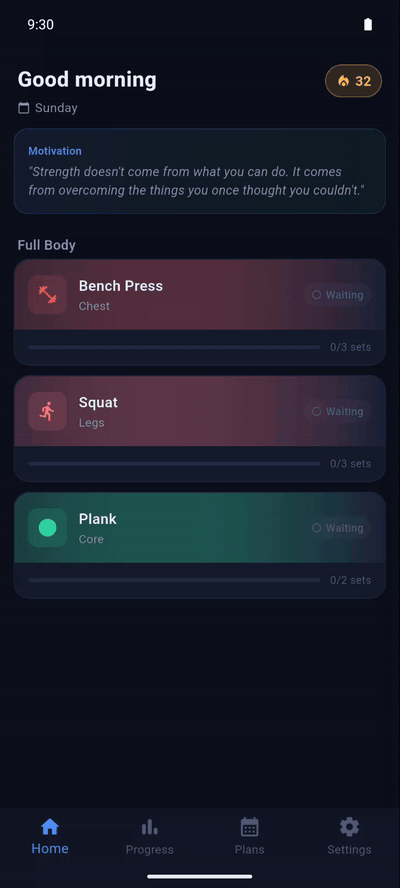

<div align="center">

# 💪 FitForge


> **Why not you?**

A personal fitness tracker built with Flutter — plan your workouts, log your sets, and watch your strength grow over time.



</div>

---

## 📥 Download

**No Google Play account needed.** Download the latest APK directly from [GitHub Releases](../../releases/latest) and install it on your Android device.

> ⚙️ You'll need to enable **Install from unknown sources** in your Android settings.

---

## ✨ Features

### 🗓️ Workout Planning
- Create workout plans assigned to specific days of the week; rename a plan or move it to another day anytime
- Pick from 230+ predefined exercises or create your own
- Muscle groups: Chest, Back, Shoulders, Biceps, Triceps, Legs, Core, Forearms, Bodyweight
- Exercise types: weighted, bodyweight (reps) and timed (seconds)
- Each plan has its own targets (sets, reps, starting weight), editable anytime — e.g. heavy 5×5 on Monday
  and a lighter 3×10 on Thursday for the same exercise
- One exercise, one history: an exercise used in several plans shares its workout history
- Add exercise descriptions, YouTube tutorial links and custom images

### 🏠 Home
- Today's workouts with each exercise's progress (sets done / planned)
- **Streak**: a day counts when every workout planned for it is done (all exercises, all sets ticked)
- **Move a workout** to another day when something comes up, without breaking the streak:
  - any day from today until the day before the plan's next regular day, earlier included
  - never into the past; move it again or back to its own day as long as that day hasn't passed
  - a workout you've already started can't be moved
  - the original day shows "moved to Saturday 7.11.", the new day shows "from Thursday 5.11."
  - if a moved workout isn't done by then, the streak breaks from its original day
- **Coming up**: the next days' workouts, so one can be pulled to today (also shown on rest days)
- Weekly summary: volume vs the same days last week and new personal records

### 🏋️ Workout Logging
- Log sets in real time with actual weight and reps
- Mark sets as completed with a single tap
- **Rest timer** starts after each completed set, with +15 s and skip; a countdown notification and
  a "rest is over" alert keep working when the phone is locked
- Exercise description shown while logging, editable right there
- Add optional notes to each session; last session's note is shown as a reminder and can be edited or deleted
- View total volume for the current session
- Auto-fills from today's session, the progression suggestion or your last session in that plan
- **Repeat identical**: fill every set exactly like last time (before any set is ticked)
- Personal best hint when today's weight is below your best ever for that exercise
- Optional "how did it feel" prompt (easy / ok / hard) when ticking a set — saved for later, can be turned off

### 📈 Automatic Progression
- Set-count rule: after N good sets in a row at the same weight (default 8), the next set goes up,
  then one more set moves up each workout until all sets are at the new weight —
  e.g. 10·10·10 / 10·10·10 / 10·10·**12.5** / 10·**12.5·12.5** / **12.5·12.5·12.5** (count starts again: 3/8)
- A missed set (fewer reps than planned) or a different weight starts the count again
- While moving up, a missed set at the new weight repeats that week until it's clean
- Increment and "sets before increase" per exercise (e.g. +2.5 kg curls, +10 kg deadlift)
- Bodyweight exercises go up in reps, timed exercises in seconds
- Live while logging: ticking a set updates the remaining sets and the banner ("6/8 sets at 10 kg — then 12.5 kg")
- The banner turns amber as soon as you beat last time in this session, and warns when you've been
  stuck at the same level for 3 sessions (try a lighter weight or change the reps)
- Can be turned off for the whole app or per exercise

### 📊 Progress Tracking
- Line chart showing max weight per session, with **estimated 1RM** (Epley formula);
  bodyweight and timed exercises chart reps / seconds instead
- Tap a point on the chart to jump to that session in the history list
- Bar chart showing volume per session (last 7 sessions)
- Stat cards: max weight, number of sessions, strength growth %
- Personal record card with date and best estimated 1RM
- Filter by period: 1 month, 3 months, 6 months, or all time
- Combined history for each exercise across all plans
- **History** list of sessions: swipe right to edit the note, left to delete it (the sets are kept)

### 💾 Backup
- Export all plans, exercises, workout history and moved workouts to a JSON file
- Import a backup on a new phone or after reinstalling (replaces current data; images are not included)

### 💬 Motivational Quotes
- A new motivational quote every time you come back to the Home screen
- Add your own custom quotes
- Toggle individual quotes on/off
- Your quotes take priority over built-in ones

### 🌍 Localization
- Three languages supported: English, Serbian (Latin), Serbian (Cyrillic)
- Language selector in Settings
- All UI strings fully translated

### ⚙️ Settings
- Automatic increase on/off, default sets before increase and default increment
- Rest timer length (or off)
- Ask how each set felt on/off
- Export / import data
- Language selection
- Motivational quote management
- Full data reset option
- Hidden developer options (tap the version 7 times): load demo data — sample plans and 8 weeks of history

### 🚀 Onboarding
- 3-screen onboarding for new users
- Explains the Plan → Workout → Progress flow
- Skip option available
- Only shown on first launch

---

## 🛠️ Tech Stack

| Layer | Technology |
|---|---|
| Framework | Flutter 3 / Dart 3 |
| State management | Riverpod 2 |
| Navigation | GoRouter 13 |
| Local database | SQLite (sqflite) |
| Charts | fl_chart |
| Localization | flutter_localizations + intl |
| Image picker | image_picker |
| Backup files | file_picker |
| Notifications | flutter_local_notifications |
| App version | package_info_plus |
| Splash screen | flutter_native_splash |
| App icon | flutter_launcher_icons |

---

## 🏗️ Architecture

Feature-first, layered architecture:

```
lib/
├── core/
│   ├── constants/        # predefined exercise library
│   ├── models/
│   ├── router/
│   ├── services/         # rest timer notifications
│   ├── theme/
│   └── utils/            # progression, 1RM, error handling
├── data/
│   ├── local/
│   │   ├── dao/
│   │   └── database_helper.dart   # schema + migrations
│   ├── models/
│   ├── repositories/
│   └── providers.dart    # dependency wiring (Riverpod)
├── features/
│   ├── onboarding/
│   ├── progress/
│   ├── settings/
│   ├── workout_log/
│   └── workout_plan/
├── l10n/
└── shared/
    └── widgets/
```

**Data flow:** UI → Riverpod provider → Repository → DAO → SQLite.
DAOs and repositories are created in `data/providers.dart` and injected, so tests can swap them.

---

## 🗄️ Database Schema

| Table | Description |
|---|---|
| `workout_plans` | Plans with day of week |
| `plan_reschedules` | One-off moves of a plan's workout from its regular day to another day |
| `exercises` | Global exercise catalogue: name (unique), muscle group, type, description, image, YouTube URL |
| `plan_exercises` | An exercise placed in a plan, with its order and the date it was added |
| `default_sets` | Target sets per plan exercise (reps, weight, increment) |
| `workout_logs` | Logged sessions: exercise, plan slot, date and note |
| `workout_sets` | Individual sets within a log, with how the set felt |
| `motivational_quotes` | User-defined motivational quotes |

**Upgrading from 1.2.x:** the database is migrated automatically on first launch. Exercises with the
same name in different plans are merged into one exercise; every plan keeps its own targets and all
workout history is kept.

---

## 🚀 Getting Started

```bash
# Clone the repo
git clone https://github.com/pero-grubac/fit_forge.git
cd fit_forge

# Install dependencies
flutter pub get

# Generate localizations
flutter gen-l10n

# Run on connected device
flutter run

# Run the tests
flutter test
```

---

## 📦 Build

```bash
# Debug APK
flutter build apk --debug

# Release APK
flutter build apk --release
```

Release APK will be at:
```
build/app/outputs/flutter-apk/app-release.apk
```

